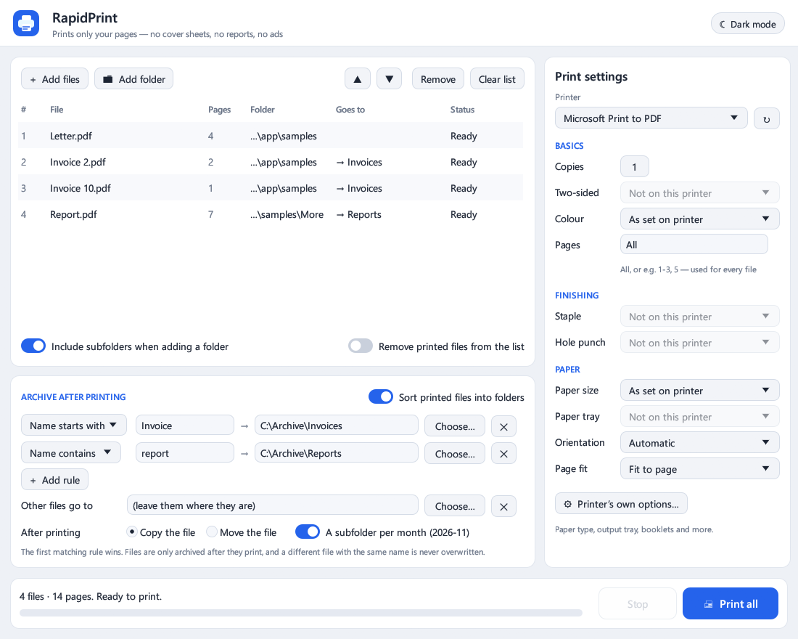
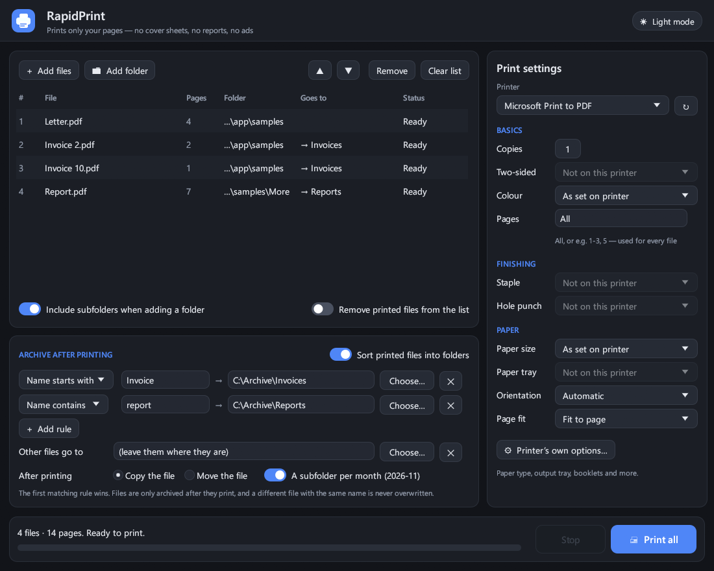

# RapidPrint

**Print many PDF files at once — only your own pages.** No cover sheets, no job reports, no ads, no
"printed with…" pages. Drop in files or whole folders, pick a printer and press **Print all**.



## Features

- **Bulk printing** of PDF files and folders (with or without subfolders), in the order you choose.
- **Only your pages.** Pages are drawn straight onto the printer with [PDFium](https://pdfium.googlesource.com/pdfium/), the PDF engine used by Chrome. Nothing else is added.
- **Printer settings:** copies, two-sided (long or short edge), colour or black & white, page range (`All`, `1-3, 5`, `last`), paper size, paper tray, orientation, fit to page.
- **Stapling and hole punching** on printers that support them (read from the printer driver through the Windows Print Ticket API).
- **The printer's own options window** for everything else (paper type, output tray, booklets…). Your choices are remembered per printer.
- **Archive after printing:** rules such as *"name starts with `Invoice` → `D:\Archive\Invoices`"* copy or move each printed file to the right folder. You can also pick a folder for all other files and a subfolder per month. A different file with the same name is never overwritten.
- **Drag and drop**, **Send to › RapidPrint** in Explorer, light and dark mode.
- **Installs per user**, without administrator rights: Start menu, desktop and *Send to* shortcuts, and an entry under *Settings › Apps* for removal.
- Small (about 6 MB plus the PDF engine), with no internet connection, no accounts and no tracking.



## Download and install

1. Download **RapidPrint-windows-x64.zip** from the [latest release](../../releases/latest).
2. Right-click the zip, choose **Extract All…**, and open the extracted folder.
3. Double-click **RapidPrint**. The first time, it offers to install itself (Start menu, desktop, *Send to*).

RapidPrint isn't code-signed, so Windows SmartScreen may say *"Windows protected your PC"*. Click
**More info › Run anyway**. Some company computers block unsigned programs completely. If yours does, ask your IT department.

Requirements: Windows 10 or 11, 64-bit.

## Using it

| To do this | Do this |
|---|---|
| Add PDFs | Drag files or folders onto the window, use **Add files** / **Add folder**, or right-click PDFs in Explorer › **Send to › RapidPrint** |
| Change the order | Select rows (Ctrl/Shift for several), then ▲ / ▼ |
| Print | Choose the printer and settings on the right, then **Print all** |
| Sort printed files | Switch on **Sort printed files into folders**, then **Add rule** |

Rules are checked from top to bottom, and the first one that matches decides the folder. Matching ignores
upper/lower case and treats spaces, `_` and `-` alike. Files are only copied or moved after they have
printed successfully.

Settings are saved in `%APPDATA%\RapidPrint\settings.json`.

To uninstall, go to **Settings › Apps › Installed apps › RapidPrint › Uninstall**.

## Building from source

1. Install [Rust](https://rustup.rs/) (stable).
2. Download `pdfium-win-x64.tgz` from [pdfium-binaries](https://github.com/bblanchon/pdfium-binaries/releases/latest)
   and put `bin\pdfium.dll` in the `vendor` folder (see [vendor/README.md](vendor/README.md)).
3. Build and run:

   ```
   cargo build --release
   target\release\RapidPrint.exe
   ```

`cargo test` runs the unit tests. `cargo test -- --ignored --nocapture` also lists your printers and
prints two sample PDFs to *Microsoft Print to PDF*.

Every push is built and tested by GitHub Actions. Pushing a tag such as `v2.0.1` builds the release zip
and attaches it to a GitHub release automatically.

### Command line

```
RapidPrint.exe [files or folders...]      open with these PDFs in the list
RapidPrint.exe --install | --uninstall
RapidPrint.exe --screenshot out.png       draw the window, save a picture, exit
```

## How it works

- `src/printing.rs` lists printers, reads what they can do, builds the printer settings (DEVMODE plus a Print
  Ticket for stapling and punching) and sends each PDF as one print job.
- `src/pdfium.rs` loads `pdfium.dll` and draws the pages onto the printer.
- `src/app.rs` contains the window (built with [egui](https://github.com/emilk/egui)).
- `src/common.rs` holds the archive rules, file finding and settings.
- `src/installer.rs` handles the per-user install, shortcuts and uninstall.
- `src/brand.rs` and `src/brand_public.rs` set the name, colours, icon and default rules.

## License

[MIT](LICENSE). RapidPrint uses open-source components. See [THIRD-PARTY-NOTICES.md](THIRD-PARTY-NOTICES.md).
